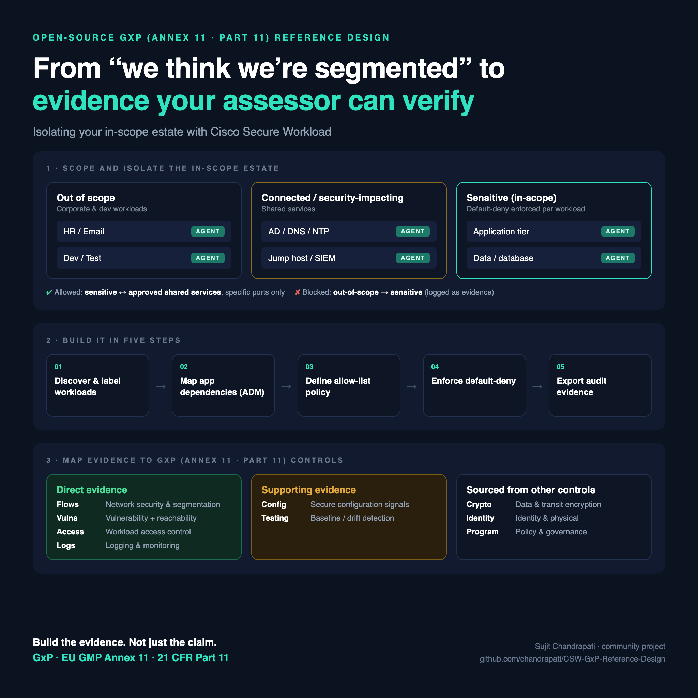
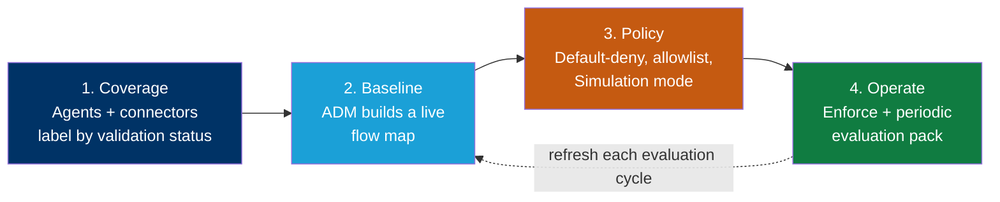
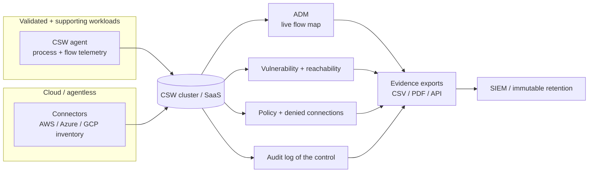
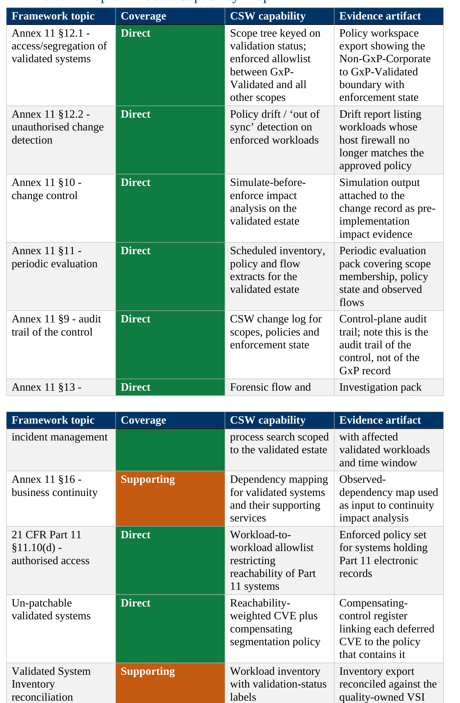

# Cisco Secure Workload — GxP Reference Design





> A step-by-step blueprint for building **Cisco Secure Workload (CSW)** so a life-sciences organisation can segregate its **validated estate** from everything else and produce the **machine-generated evidence** an inspector expects under **EU GMP Annex 11** and **21 CFR Part 11** — segmentation, live flow maps, change-drift detection, vulnerability reachability, and periodic-evaluation exports.

**GxP is a regulatory regime enforced by inspection, not a certification scheme.** There is no GxP certificate to obtain, and CSW does not confer compliance. CSW turns workload communication, process activity, and inventory into **evidence** that your quality, validation, and IT-compliance functions can file alongside the controls they already own.

---

## Read this before anything else — the scope boundary

This is the part most vendor mappings skip. CSW sits at the **network and workload-communication layer**. GxP compliance is overwhelmingly about the **record** and the **process**, and CSW touches neither.

| CSW does **not** | Who owns it |
|---|---|
| Computer System Validation — IQ/OQ/PQ of the regulated application | Validation / quality |
| Record-level ALCOA+ attributes | The regulated application itself |
| Electronic signatures (21 CFR Part 11 Subpart C) | The regulated application |
| Application-level audit trails and audit-trail review | Application owner + QA |
| QMS, SOPs, deviation and CAPA processes | Quality |
| Supplier qualification and vendor assessment | Procurement + quality |
| Data-integrity governance and periodic data-integrity review | Quality |

Two points worth stating plainly to a customer:

1. **The CSW audit trail is the audit trail of the *control*, not of the GxP *record*.** Annex 11 §9 expects an audit trail over GxP-relevant changes to data. CSW gives you a defensible trail over changes to the segmentation control. Those are different artefacts, and conflating them is the fastest way to lose an inspector's confidence.
2. **Where CSW is relied upon as a GxP control, your quality function may require CSW itself to be qualified.** Budget for that conversation early rather than discovering it during a periodic review.

---

## What's in this repo

| Document | For | Use it to |
|---|---|---|
| **[Reference Design](CSW-GxP-Reference-Design.md)** | SE / platform / security engineering | Build CSW end-to-end: scope architecture keyed on validation status, ADM, enforcement, per-clause evidence |
| **[Compliance Report](#the-compliance-report--what-your-inspector-gets)** ([PDF](CSW-GxP-Compliance-Report.pdf) · [DOCX](CSW-GxP-Compliance-Report.docx)) | Quality, validation, IT compliance | Hand over a colour-coded clause-by-clause mapping plus the exact evidence package |
| **[Evidence Checklist](docs/evidence-checklist.md)** | Evidence owner | A printable "what to export, from where, how often" worklist |
| **[POV / Workshop Plan](docs/pov-plan.md)** | SE + customer | Run a scoped 45-day proof-of-value on one validated boundary |

---

## How CSW produces evidence — the big picture



Each phase produces a specific, exportable artefact. The **[Reference Design](CSW-GxP-Reference-Design.md)** maps every artefact to a clause.

---

## The scope tree that does the work

Most CSW scope trees are keyed on application or environment. For GxP, key the **first level on validation status** — because that is the boundary Annex 11 §12.1 actually asks you to defend.

```
GxP
├── GxP-Validated          MES, LIMS, EBR, SCADA historian, chromatography data systems
├── GxP-Supporting         Backup, monitoring, time sync, infrastructure services
├── Non-GxP-Corporate      Office IT, email, general business applications
└── External-Partners      CDMO, CRO, instrument-vendor remote support
```

> **The `Non-GxP-Corporate` → `GxP-Validated` boundary is the single most valuable policy in this entire design.** It is the control Annex 11 and GAMP both expect, and the one most customers can currently only assert on paper.

---

## Reference architecture at a glance



---

## Coverage snapshot

CSW provides **🟢 Direct** evidence for **8** mapped clause areas, **🟠 Supporting** input for **2**, and marks **⚪ Evidence Required** *(supplied outside CSW)* for **8** further areas. The full colour-coded mapping is in the Compliance Report below.

**Coverage key**

- 🟢 **Direct** — CSW produces the **primary evidence** artefact for the clause.
- 🟠 **Supporting** — CSW produces an **input that feeds or complements** another control's evidence.
- ⚪ **Evidence Required** *(supplied outside CSW)* — CSW produces **nothing** here. The area is **in scope for GxP but out of scope for CSW**; the customer supplies the evidence through **another control, tool, or process**. This marks a **boundary, not a gap or a failure.**

> Coverage describes what evidence CSW produces — **not** that a clause is satisfied, and ⚪ never means a clause is unsupported.

### Where the Direct evidence lands

| Clause | What CSW gives you |
|---|---|
| **Annex 11 §12.1** — access / segregation | Enforced allowlist between `GxP-Validated` and every other scope |
| **Annex 11 §12.2** — unauthorised change | Policy drift report naming workloads whose host firewall no longer matches approved policy |
| **Annex 11 §10** — change control | Simulate-before-enforce impact analysis attached to the change record |
| **Annex 11 §11** — periodic evaluation | Scheduled inventory, policy and flow extracts for the validated estate |
| **Annex 11 §9** — audit trail *of the control* | CSW change log for scopes, policies and enforcement state |
| **Annex 11 §13** — incident management | Forensic flow and process search scoped to validated systems |
| **21 CFR Part 11 §11.10(d)** — authorised access | Workload-to-workload allowlist for systems holding Part 11 records |
| **Un-patchable validated systems** | Reachability-weighted CVE paired with the containing policy |

---

## The highest-value conversation: systems you cannot patch

A validated system often cannot be patched without triggering revalidation. The patch is deferred, the CVE stays open, and the finding recurs at every audit.

CSW turns that standing finding into a **documented compensating control**: the deferred CVE is paired with the enforced policy that restricts what can reach the vulnerable system, and the pairing is exported as a register. The vulnerability is still open — but the exposure is now bounded and evidenced rather than merely acknowledged.

This is usually where a life-sciences buyer first sees why the platform is worth paying for. The **[Reference Design](CSW-GxP-Reference-Design.md)** walks the full workflow.

---

## The Compliance Report — what your inspector gets

The snapshot above is the summary. The **[Compliance Report](CSW-GxP-Compliance-Report.pdf)** is the artefact you actually hand over — a clause-by-clause mapping that turns "we use Cisco Secure Workload" into a defensible, colour-coded evidence story.

[](CSW-GxP-Compliance-Report.pdf)

*Every clause, the matching CSW implementation, and a colour-coded coverage verdict — green (Direct), amber (Supporting), grey (Evidence Required — supplied outside CSW).* **[Open the full report →](CSW-GxP-Compliance-Report.pdf)**

### Why a quality function values it

- **Speaks the regulation's language.** Rows are keyed to Annex 11 clause numbers and Part 11 paragraphs, so QA can line them up against the validation plan without translation.
- **One-glance coverage verdict.** The colour-coded **Coverage** column shows instantly where CSW is the *primary* evidence source, where it is a *supporting* input, and where **other controls must supply the evidence**.
- **Names the exact artefact and its cadence.** The evidence-package table maps each clause to a specific CSW export and how often to collect it — so the evidence owner knows precisely what to produce and can reproduce it on demand.
- **Shows the control operating, not just existing.** Segregation is backed by enforced default-deny policy and logged denied connections.
- **It is honest about its boundaries — and that builds trust.** The report openly flags that CSW performs no CSV, produces no record-level ALCOA+ evidence, and offers no electronic signatures. Inspectors and auditors trust a vendor mapping far more when it marks its own limits.
- **Continuous, not an annual snapshot.** Every row points at a live, re-exportable CSW artefact, so the pack regenerates for each periodic evaluation.

> It is **evidence**, not an attestation. Your quality function and your inspector still determine compliance status — this report makes that assessment faster and your position defensible.

---

## Start here

1. Read the **[Reference Design](CSW-GxP-Reference-Design.md)** — scope architecture and the CSW build steps.
2. Agree the **validated-system boundary** with quality and validation, and reconcile it to the Validated System Inventory.
3. Run the **[POV plan](docs/pov-plan.md)** on one validated boundary.
4. Track exports with the **[Evidence Checklist](docs/evidence-checklist.md)**.
5. Share the **[Compliance Report](CSW-GxP-Compliance-Report.pdf)** with quality and IT compliance.

---

## References & official sources

Authoritative sources for **GxP computerised-system controls**. The EU is revising Annex 11 — always validate clause numbers and versions against the text in force for your market before customer use.

- [EudraLex Volume 4, Annex 11 — Computerised Systems](https://health.ec.europa.eu/medicinal-products/eudralex/eudralex-volume-4_en)
- [21 CFR Part 11 — Electronic Records; Electronic Signatures](https://www.ecfr.gov/current/title-21/chapter-I/subchapter-A/part-11)
- [FDA — Computer Software Assurance for Production and Quality System Software (draft guidance, September 2022)](https://www.fda.gov/regulatory-information/search-fda-guidance-documents/computer-software-assurance-production-and-quality-system-software)
- ISPE — GAMP 5: A Risk-Based Approach to Compliant GxP Computerized Systems, Second Edition (2022)
- Cisco Secure Workload — [product documentation](https://www.cisco.com/c/en/us/support/security/secure-workload/series.html)

---

## Disclaimer

This repository is for informational and planning purposes. It is **not** legal, regulatory, validation, audit, or certification advice, and it is **not** a GxP attestation — GxP is enforced by inspection and no certificate exists. Validate all clause references against the current official Annex 11 and 21 CFR Part 11 text, your environment, and your qualified quality and validation functions. Replace any bracketed fields before customer delivery.

*Part of the Cisco Secure Workload compliance reference-design series. Umbrella index: [CSW-Compliance-Reference-Designs](https://github.com/chandrapati/CSW-Compliance-Reference-Designs).*
