# GxP (Annex 11 · 21 CFR Part 11) — CSW POV / Workshop Plan

A ~45-day proof-of-value that stands up CSW evidence on **one** validated boundary. The goal is a repeatable evidence pack and quality-function confidence — not an estate-wide rollout.

> Scope one validated system and its supporting services. Instrumenting the whole estate during a POV is the most common way POVs stall — and in a GxP environment it also drags the change-control burden forward before anyone has seen value.

```mermaid
gantt
    dateFormat  X
    axisFormat  Day %s
    section Coverage
    Instrument + label by validation status  :a1, 0, 10
    section Baseline
    ADM observation (>=2 wks)                 :a2, 10, 18
    System-owner + QA signoff                 :a3, 24, 4
    section Policy
    Author + Simulation (>=1 wk)              :a4, 29, 10
    section Operate
    Enforce + evaluation pack                 :a5, 39, 6
```

## Prerequisites

- The **Validated System Inventory (VSI)** extract, or whatever quality uses in its place.
- A named contact in **quality / validation** — not just IT. The boundary is theirs to confirm.
- The GxP change-control process for the enforcement step, and agreement on whether enabling enforcement is itself a change requiring assessment.
- Last periodic-review findings, so exports line up with what was already asked for.

> Agree up front whether the POV touches production validated systems or a qualified test environment. In many organisations the first pass must run in the test estate.

## Day-by-day

### Days 1–10 — Coverage
- Deploy agents across the chosen validated system and its supporting services; add cloud connectors for agentless inventory.
- Apply labels keyed on **validation status** first (`GxP-Validated`, `GxP-Supporting`, `Non-GxP-Corporate`, `External-Partners`), then application and owner.
- Record a **cannot-instrument register** — legacy instrument controllers and vendor appliances usually land here, and the register is itself evidence.
- **Milestone:** coverage of the boundary (or justified exceptions) plus an inventory export reconciled against the VSI.

### Days 11–28 — Baseline
- Run ADM across a full business cycle (≥ 2 weeks; extend across a batch run or month-end).
- Review discovered clusters with system owners and QA. Expect to surface instrument-vendor remote support, undocumented CDMO/CRO paths, and corporate-IT reach into validated systems that nobody had evidenced.
- **Milestone:** system owners sign the cluster-to-system mapping; ADM flow map exported.

### Days 29–45 — Policy → Operate
- Import ADM flows; set **default-deny** on the validated scope; make each allow explicit; log the exception register.
- Run **Simulation ≥ 1 week** — every would-deny becomes a change ticket, not a deviation.
- Attach the simulation output to the change record as **pre-implementation impact evidence** (Annex 11 §10).
- Resolve false positives, **enforce**, and capture a negative test in Denied Connections.
- **Milestone:** enforcement live on the `Non-GxP-Corporate` → `GxP-Validated` boundary, plus the first evaluation pack assembled.

## Exit criteria

- [ ] Boundary coverage achieved (or documented exceptions in the cannot-instrument register)
- [ ] Inventory export reconciled against the Validated System Inventory
- [ ] Signed ADM flow map = the live system-interface artefact
- [ ] Default-deny enforced at the validated boundary with a logged denied connection
- [ ] Simulation report + exception register filed against the change record
- [ ] Drift report demonstrated on at least one deliberate out-of-band change
- [ ] Compensating-control register produced for one deferred CVE on an un-patchable system
- [ ] A periodic-evaluation pack quality can consume without a live walkthrough

## Deliverables

- Evidence pack per the [Evidence Checklist](evidence-checklist.md)
- Policy + simulation exports and the exception register
- Compensating-control register for deferred patches on validated systems
- A short readout mapping each export to the Annex 11 clause it supports

---

*Tune cadence to the customer's periodic-review schedule and risk appetite. Validate evidence sufficiency with quality and validation. CSW evidence is an input to GxP control assurance, not an attestation — and where CSW is relied upon as a GxP control, quality may require CSW itself to be qualified.*
